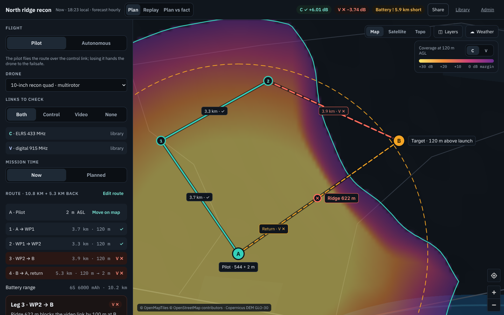
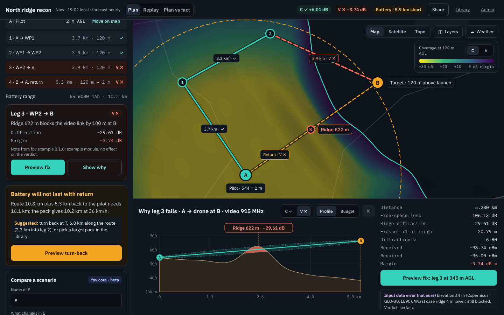
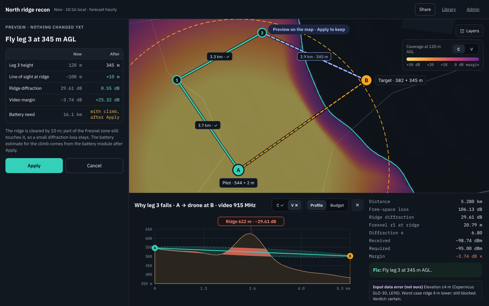
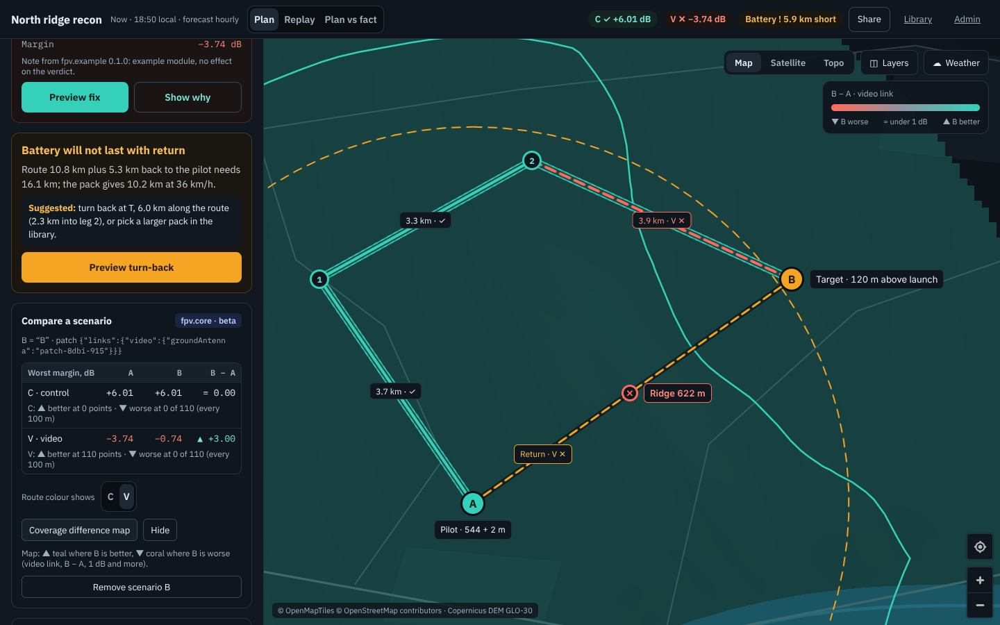
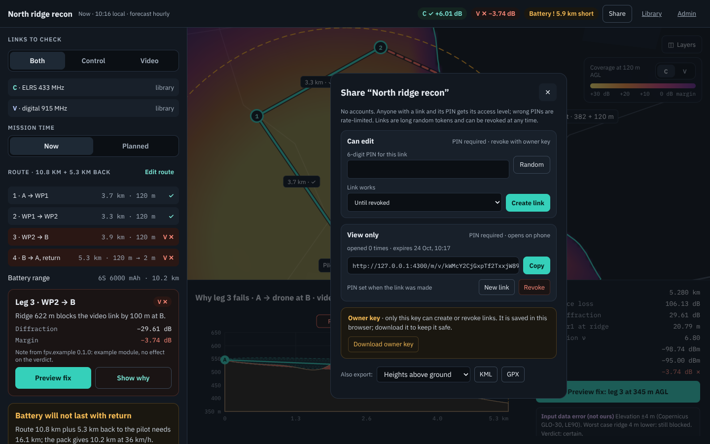
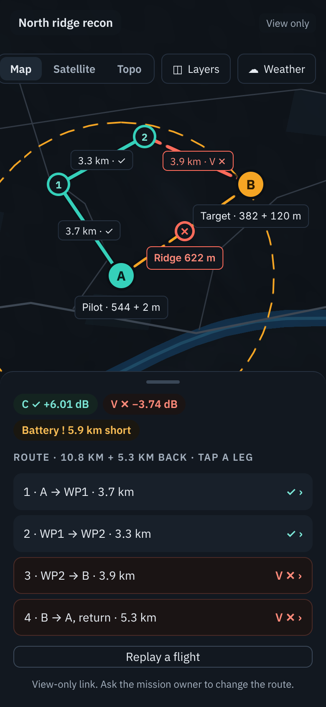
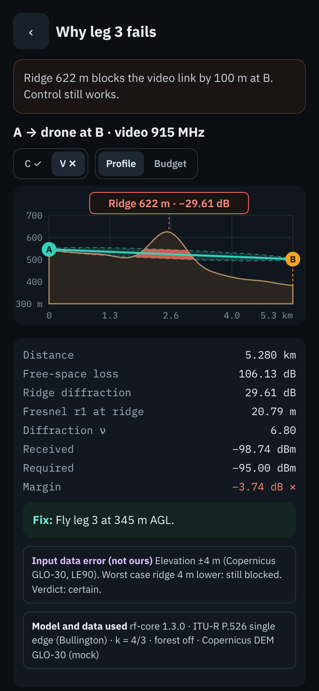
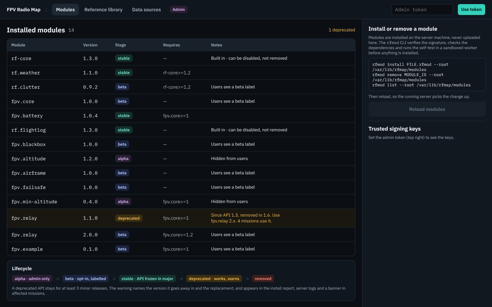
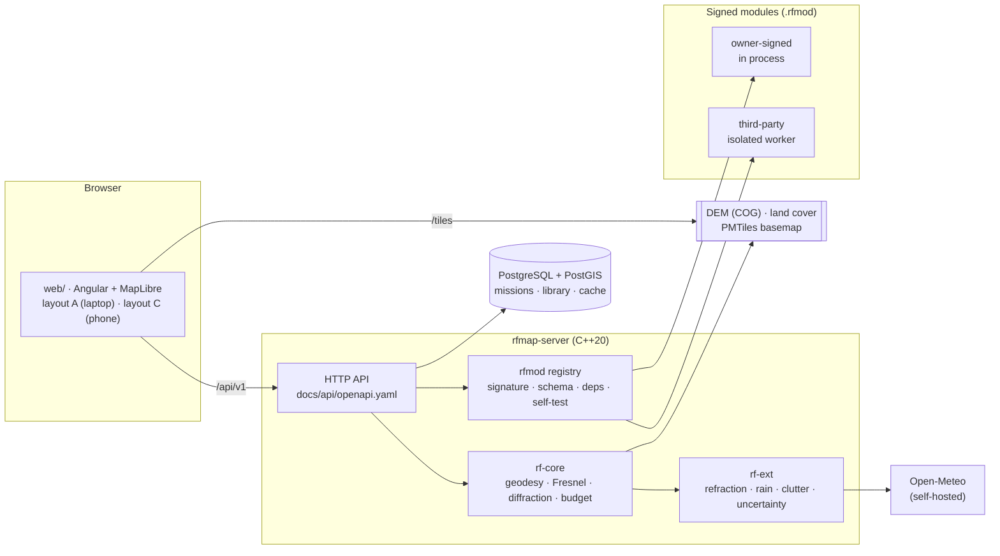

<div align="center">

# FPV Radio Map

**Will my control and video link reach the target, and if not, why?**

Plan an FPV route on the map and see each radio link the way the terrain sees it:
Fresnel zone, ridge diffraction, coverage heatmap, maximum range, battery, and a fix you can preview before applying it.

[](https://github.com/Rufics/fpv-radio-map/actions/workflows/main.yml)
[](https://github.com/Rufics/fpv-radio-map/actions/workflows/ci.yml)
[](https://github.com/Rufics/fpv-radio-map/releases)
[](LICENSE)
<br>
[](#roadmap)
[](https://www.conventionalcommits.org/en/v1.0.0/)
[](https://github.com/semantic-release/semantic-release)
[](core/rf-core)
[](web)
[](web)



<sub>Screenshots are from the demo build with sample data (<code>npm run build:mock</code> in <code>web/</code>).</sub>

</div>

## Why

FPV pilots lose links behind hills, past ridges and at the far end of long routes, usually without knowing which of these
it was. Generic coverage maps answer "is there signal here". This project answers the questions a pilot asks before take-off:

- **Will the control link and the video link hold along the whole route?** Each is evaluated separately: different
  frequency, power, antennas and receiver sensitivity.
- **If a point is unreachable, what blocks it?** The terrain profile, the first Fresnel zone, the obstructing ridge and
  its diffraction loss, in dB.
- **What would fix it, and what does the fix cost?** Fly higher on one leg, move the launch point, add a relay, turn
  back earlier. Every fix is previewed before it changes the mission.
- **How sure is the answer?** The stated error of the elevation data is carried through the calculation. A verdict
  reads *reliable*, *marginal* or *blocked*, and says when the result could go either way.

### Principles

- **Exact maths, no fudge factors.** Fresnel integrals and the knife-edge function J(ν) are computed exactly,
  diffraction uses the Bullington method on a k·R earth, and distances use Karney's geodesics on WGS-84. Where an input
  has error we don't control (DEM, forecast, datasheets), the result says so instead of hiding it.
- **Reference data lives in the database, not in code.** Radio profiles, antennas, batteries and drones come from a
  library that only the server admin can mark as verified. Every seeded value names its source.
- **Extensible and safe.** Features ship as signed modules (ed25519). Modules from third parties run in a separate,
  sandboxed process, and only the admin installs them.

## What it looks like

<table>
<tr>
<td width="50%"></td>
<td width="50%"></td>
</tr>
<tr>
<td><b>Why it fails.</b> Terrain profile with the first Fresnel zone, the obstructing ridge and every term of the link budget.</td>
<td><b>Preview a fix.</b> Nothing changes until you apply it. The table shows the effect on every link and the battery.</td>
</tr>
<tr>
<td></td>
<td></td>
</tr>
<tr>
<td><b>Compare two setups.</b> For example a different antenna or frequency: worst margins side by side, and the route coloured by B − A.</td>
<td><b>Share and export.</b> Read-only links protected by a PIN that the owner can revoke, plus KML and GPX.</td>
</tr>
</table>

<p align="center">

&nbsp;

&nbsp;

<br>
<sub>Phone layout for the field, and the admin page for signed modules.</sub>
</p>

## Features

| | Feature | Where |
|---|---|---|
| 📡 | Control and video links, each with its own radio, antennas and sensitivity; evaluated separately or together | server, `rf-core` |
| ⛰️ | Terrain profile, first Fresnel zone, Bullington diffraction, coverage heatmap and maximum range | `rf-core` |
| 🌦️ | Refraction from the forecast (ITU-R P.453) and rain loss (ITU-R P.838-3), including future dates | `rf-ext`, Open-Meteo |
| 🌲 | Forest and buildings from land-cover classes, with obstacle heights set by the admin | `rf-ext` |
| ± | Uncertainty band from the DEM's stated error: *reliable*, *marginal*, *blocked*, *blocked, may work* | `rf-ext` |
| 🔋 | Battery range with wind, temperature and climb, and a turn-back point when the pack won't last | `fpv.battery` |
| ↕️ | Minimum altitude along the route that keeps the Fresnel zone clear | `fpv.min-altitude` |
| 🏠 | Failsafe check: where the link is lost, and whether return-to-home clears the terrain | `fpv.failsafe` |
| 📍 | Best launch point inside an area you draw | `fpv.best-launch` |
| 🔁 | Relay placement: budget per hop and the best relay spot | `fpv.relay` |
| ⚖️ | Scenario compare, KML and GPX export | `fpv.core` |
| 🔗 | Read-only share links with a PIN; only the owner key revokes them | server |
| 📚 | Equipment library: radios, antennas, batteries, drones, with sources and admin-verified flags | server, web |

## Architecture



| Path | What it is |
|---|---|
| [`core/rf-core`](core/rf-core) | Units, WGS-84 geodesy, exact Fresnel integrals, Bullington diffraction, link budget |
| [`core/rf-ext`](core/rf-ext) | Refraction, rain, clutter, uncertainty analysis |
| [`platform/rfmod`](platform/rfmod) | Module ABI, signed package format, registry, sandboxed worker, `rfmod` CLI |
| [`modules/fpv`](modules/fpv) | The FPV module pack |
| [`server`](server) | HTTP API, PostGIS storage, raster access, weather, result cache |
| [`web`](web) | `@rfmap/ui-kit` and the FPV app |
| [`tools/tiles-builder`](tools/tiles-builder) | Builds the DEM COG, hillshade, contours, basemap and satellite PMTiles |
| [`deploy`](deploy) | Docker Compose: PostGIS, Open-Meteo, server, web |
| [`examples/modules/body-shadow`](examples/modules/body-shadow) | A small example module to start from |

## Quick start

**Try the interface with sample data** (no server needed):

```sh
cd web
npm ci --ignore-scripts
npm run start:mock-prod      # then open http://localhost:4200
```

**Run the whole stack** with Docker. You need terrain tiles from the [tiles builder](docs/admin/tiles-builder.md) first.

```sh
cd deploy
cp .env.example .env         # set POSTGRES_PASSWORD, RFMAP_ADMIN_TOKEN, RFMAP_TILES_DIR
docker compose up -d --build
```

Or use the published images: `ghcr.io/rufics/fpv-radio-map-server` and `ghcr.io/rufics/fpv-radio-map-web`
(`:edge` follows `main`; releases are tagged `X.Y.Z`). See [docs/admin/deploy.md](docs/admin/deploy.md).

**Build and test from source** (Linux; Ubuntu 24.04 packages are listed in [CONTRIBUTING.md](CONTRIBUTING.md#checks)):

```sh
cmake -S . -B build -G Ninja && cmake --build build && ctest --test-dir build
```

## Documentation

All documentation lives in [`docs/`](docs/README.md) and is published to the [wiki](https://github.com/Rufics/fpv-radio-map/wiki) on every change.

- [Glossary](docs/guide/glossary.md) and [FAQ](docs/guide/faq.md)
- [Server deployment](docs/admin/deploy.md) and the [tiles builder](docs/admin/tiles-builder.md)
- [HTTP API (OpenAPI)](docs/api/openapi.yaml)
- [Writing a module](docs/modules/developer-guide.md): C ABI, host calls, UI bundles, signing, deprecation
- [Web frontend](web/README.md)
- [Contributing](CONTRIBUTING.md): commit standard, checks, releases

## Roadmap

The core is complete and tested. The project is **alpha**: the interfaces may still change before 1.0.

**Next**
- [ ] Relay planning in the interface (the `fpv.relay` module already computes it)
- [ ] Route editing: snap to terrain features, undo
- [ ] Battery summary in the route result
- [ ] Validate weather against a live self-hosted Open-Meteo instance
- [ ] Time limits for owner-signed modules that run in the server process
- [ ] A coverage request on a given grid, for exact difference maps between any two scenarios
- [ ] A lighter export call that does not recompute the route

**Later**
- [ ] Real antenna patterns: patch, helical, dipole, pointing and bank angle, polarization mismatch
- [ ] Interference zones with a raised noise floor
- [ ] Choice of elevation data: Copernicus 30 m, SRTM or your own LiDAR
- [ ] PDF mission report
- [ ] Verified radio profiles for more systems, each with its published source

Have an idea or need? [Open an issue](https://github.com/Rufics/fpv-radio-map/issues/new/choose).

## Contributing

Contributions are welcome: code, verified equipment data with sources, modules, documentation and bug reports.
Read [CONTRIBUTING.md](CONTRIBUTING.md) and the [Code of Conduct](CODE_OF_CONDUCT.md). Report security issues privately,
as described in [SECURITY.md](SECURITY.md).

## License and data

The code is released under the [MIT License](LICENSE).

The map data has its own terms, and each deployment must show their credits. The web app shows them from the tiles
builder's `manifest.json`, and the exact texts are in [the tiles builder guide](docs/admin/tiles-builder.md#8-attribution-to-show-on-the-map):
- **Elevation:** Copernicus DEM GLO-30, © DLR e.V. 2010-2014 and © Airbus Defence and Space GmbH 2014-2018, provided
  under COPERNICUS by the European Union and ESA
- **Basemap:** © OpenStreetMap contributors (ODbL 1.0), © OpenMapTiles (CC BY 4.0)
- **Land cover:** © ESA WorldCover project 2021 (CC BY 4.0)
- **Satellite imagery:** whichever mosaic the operator builds, with the licence and credit they pass to the tiles
  builder. Licences differ by provider and year, and some allow only non-commercial use.

Check each provider's current terms before a public deployment.
