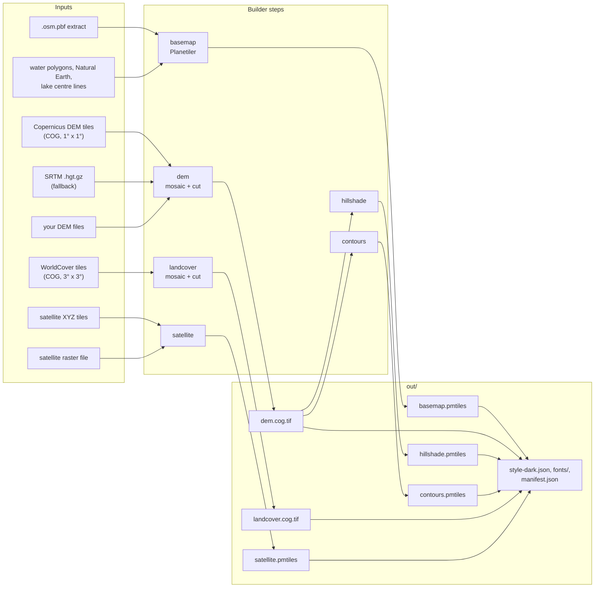
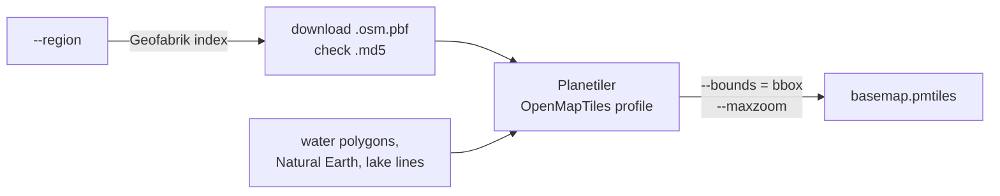
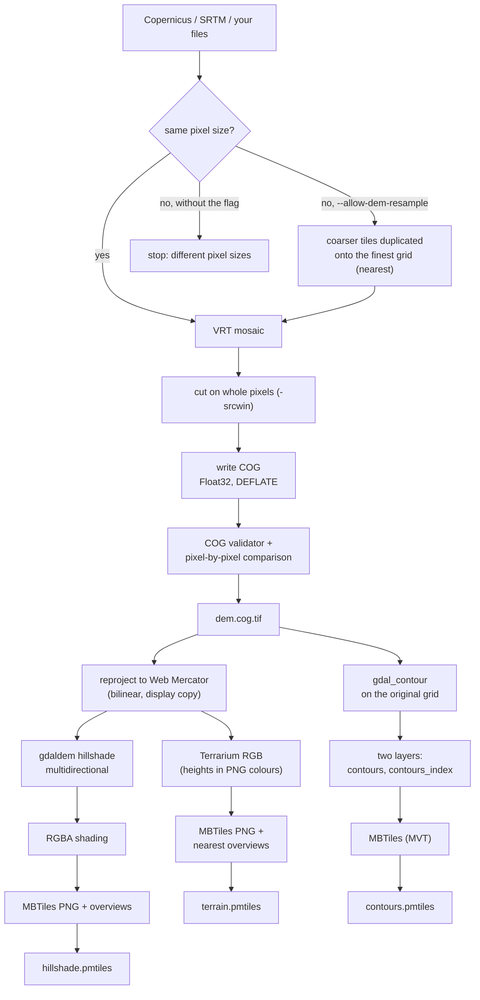
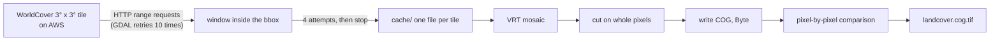
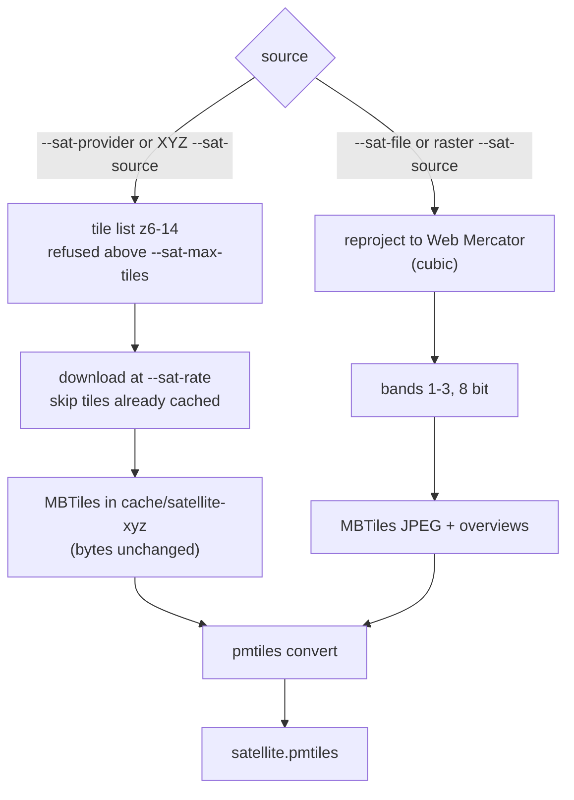
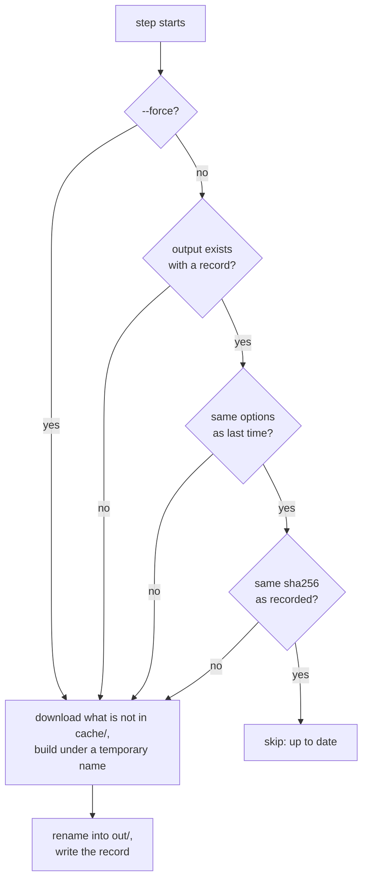

# How the tiles builder generates map data

This page describes what `rfmap/tiles-builder` does with each source: what it downloads, what it
copies unchanged, what it converts, and which formats it reads and writes. To run it, follow
[Production server, step by step](production-setup.md#2-build-the-map-data); every option is in
[Building map data](tiles-builder.md). How the finished files reach the browser is in
[How map layers reach the browser](map-layers.md).

The code is in [`tools/tiles-builder/rfmap_tiles`](../../tools/tiles-builder/rfmap_tiles), one
module per step.

## Overview

## Copied, converted or derived

The builder treats the two files the server calculates with differently from the pictures the
browser shows.

| Output | What happens to the source | Can it change a value? |
|---|---|---|
| `dem.cog.tif` | **Copied.** Source pixels are mosaicked and cut on whole pixels, then re-packed as a COG. | No. Every pixel is compared with the source and the build stops on any difference. With `--allow-dem-resample`, pixels of the coarser tiles are duplicated onto the finest grid; no height is interpolated. |
| `landcover.cog.tif` | **Copied.** The same as the DEM, for class values. | No. Every pixel is compared with the source. |
| `satellite.pmtiles` from XYZ tiles | **Copied.** Each tile's bytes go into the archive as they were downloaded. | No. JPEG, PNG or WebP stay as they are. |
| `basemap.pmtiles` | **Converted.** Planetiler turns OSM data into vector tiles in the OpenMapTiles schema. | Yes, by design: features are generalised for each zoom level. |
| `satellite.pmtiles` from a raster file | **Converted.** Reprojected to Web Mercator with cubic resampling and cut into JPEG tiles. | Yes: resampled and JPEG-compressed. Display only. |
| `hillshade.pmtiles` | **Derived** from `dem.cog.tif`. | Display only; not used in calculations. |
| `terrain.pmtiles` | **Derived** from `dem.cog.tif`: reprojected to Web Mercator (bilinear) and encoded as Terrarium RGB. | Display only, for the 3D view; not used in calculations. |
| `contours.pmtiles` | **Derived** from `dem.cog.tif`. | Display only; not used in calculations. |
| `style-dark.json`, `fonts/` | **Written** from the template in `styles/` and the fonts in the image. | — |
| `manifest.json` | **Written** from the record each step keeps. | — |

## Formats

### What the builder reads

| Step | Option | Format | Requirements |
|---|---|---|---|
| `basemap` | `--region`, `--osm-url`, `--osm-file` | OSM PBF (`.osm.pbf`) | Any extract; Geofabrik downloads are checked against their `.md5` file. |
| `basemap` | `--water-polygons-file` | `water-polygons-split-3857.zip` (Shapefile, EPSG:3857) | Downloaded from osmdata.openstreetmap.de if not given. |
| `basemap` | `--natural-earth-file` | `natural_earth_vector.sqlite.zip` (SQLite) | Downloaded from naciscdn.org if not given. |
| `basemap` | `--lake-centerlines-file` | `lake_centerline.shp.zip` (Shapefile) | Downloaded from GitHub if not given. |
| `dem` | default | Copernicus DEM GLO-30 Cloud Optimized GeoTIFF, Float32, 1° x 1° | From the public AWS bucket `copernicus-dem-30m`. |
| `dem` | `--dem-source srtm` | SRTM HGT (`.hgt.gz`, 1 arc-second) | From AWS Terrain Tiles; unpacked into the cache. |
| `dem` | `--dem-file` (repeatable) | Any single-band raster GDAL reads: GeoTIFF, COG, VRT, HGT, ... | In longitude/latitude degrees (WGS 84), like Copernicus, because the bbox is cut in pixels of the source grid. Not rotated. All files on one grid, or `--allow-dem-resample`. |
| `landcover` | `--worldcover-year` | ESA WorldCover 10 m Cloud Optimized GeoTIFF, Byte, 3° x 3° | From the public AWS bucket `esa-worldcover`; only the window inside the bbox is read. |
| `satellite` | `--sat-provider`, or an XYZ `--sat-source` | XYZ tiles in the Web Mercator tile grid, `{z}/{x}/{y}` or `{-y}` for TMS rows | JPEG, PNG or WebP; anything else stops the build. |
| `satellite` | `--sat-file`, or a raster `--sat-source` | Any raster GDAL reads: GeoTIFF, COG, VRT, ... in any projection | At least 3 bands (bands 1–3 are used as RGB). Non-8-bit data is stretched to 8 bit with a warning. A URL is downloaded into the cache first. |

### What the builder writes

| File | Format | Details |
|---|---|---|
| `basemap.pmtiles` | PMTiles v3, vector tiles (MVT) | OpenMapTiles schema, z0–16 (or `--basemap-maxzoom`), cut to the bbox unless `--basemap-full-extract`. |
| `terrain.pmtiles` | PMTiles v3, raster-dem, 256 px PNG | z6–12 by default. Terrarium encoding: height = R × 256 + G + B / 256 − 32768 m; no-data is 0 m. Overviews pick the nearest cell, because averaging encoded bytes gives wrong heights. |
| `hillshade.pmtiles` | PMTiles v3, raster, 256 px PNG | z6–12 by default. `alpha` style: RGBA, black shadows and faint white highlights on transparent; `gray`: classic grey. |
| `contours.pmtiles` | PMTiles v3, vector tiles (MVT) | Layer `contours` (every line, from z12) and `contours_index` (every 5th line, from z10), attribute `ele` in metres. |
| `satellite.pmtiles` | PMTiles v3, raster | The provider's own tiles for XYZ sources; JPEG (quality 85 by default) for raster files. z6–14 by default. |
| `dem.cog.tif` | Cloud Optimized GeoTIFF, Float32, EPSG:4326 | NoData −32768, 512 px internal tiles, DEFLATE with the floating-point predictor (lossless), averaged overviews for previews only. |
| `landcover.cog.tif` | Cloud Optimized GeoTIFF, Byte, EPSG:4326 | Class values 0 (no data) and 10–100, 512 px internal tiles, DEFLATE, overviews by majority (MODE). |
| `style-dark.json` | MapLibre style JSON | Sources use `pmtiles://` URLs under `--public-base-url`; sources whose file was not built are dropped. |
| `fonts/` | Glyph PBF ranges | Noto Sans from protomaps/basemaps-assets, SIL OFL 1.1 (`fonts/OFL.txt`). |
| `manifest.json` | JSON | Each file's size, sha256, source, source URLs, missing tiles, licence, attribution, bbox, zoom, resolution and the tool versions. |

## Step by step

### basemap

Planetiler reads the whole extract, keeps the features inside the bbox, builds vector tiles for
each zoom and writes the PMTiles archive directly. Its temporary files are in `work/planetiler`.

### dem, hillshade, terrain and contours

- Copernicus tiles that do not exist (open sea, or withheld from the public release) are
  recorded as missing and stay NoData.
- The hillshade's vertical scale is corrected by cos(latitude) at the bbox centre, because one
  Web Mercator unit is shorter than a metre away from the equator.
- Hillshade, terrain and contours are rebuilt only when the DEM's sha256 or their own options change.

### landcover

Only the window inside the bbox is read from each remote tile. A window that is already in
`cache/` needs no network at all, so a rerun after a failure downloads only the tiles still
missing.

### satellite

- Tiles are requested over reused connections to one checked address, retried on 429 and server
  errors, and stopped on 401 or 403, which usually means the service forbids bulk access.
- Tiles the provider does not have (404 or 204) are counted as not available and left empty.
- The licence and attribution come from the built-in mosaic table or from `--sat-licence` and
  `--sat-attribution`. Without `--sat-licence-checked` (or both of those), the manifest marks the
  licence `UNVERIFIED`.

### style and manifest

These run after every build command (not after `verify`). `style-dark.json` is written from
`styles/style-dark.template.json`, with each source's attribution taken from that file's record
and the sources of unbuilt files removed. `manifest.json` collects the record of every file in
`out/` and joins the attributions into `attribution_display_text`, which the server shows on the
map.

## Reruns, caching and verification

Every step decides on its own whether there is anything to do:

- **Downloads** go to `cache/` and are reused: OSM extracts, Copernicus and SRTM tiles,
  WorldCover windows, satellite tiles and downloaded rasters. An interrupted file download
  (curl) resumes where it stopped, and an interrupted satellite job keeps the tiles it already
  has. A WorldCover window that did not finish is fetched again from the start; the finished
  ones are kept. `--refresh-osm` downloads the OSM extract again.
- **Temporary files** go to `work/` and are deleted after a successful step.
- **Outputs** are written as `.tmp-<name>` and renamed into place only when finished, so `out/`
  never holds a half-written file. Each output's record is in `out/.meta/`.
- **`verify`** runs GDAL's COG validator on `dem.cog.tif` and `landcover.cog.tif` and
  `pmtiles verify` on every `.pmtiles` file.

## Tools inside the image

| Tool | Used for |
|---|---|
| Planetiler 0.10.2 (Java 21) | basemap |
| GDAL 3.12 (`gdalbuildvrt`, `gdal_translate`, `gdalwarp`, `gdaldem`, `gdal_contour`, `ogr2ogr`, `gdaladdo`, Python bindings) | DEM, land cover, hillshade, contours, satellite rasters, COG validation |
| go-pmtiles 1.31.0 | MBTiles to PMTiles, `verify` |
| curl | downloads with resume and retries |
| Python 3 (`rfmap_tiles`) | the steps, XYZ tile downloads, input checks, records and manifest |

Exact versions and checksums are pinned in [`tools/tiles-builder/Dockerfile`](../../tools/tiles-builder/Dockerfile).
