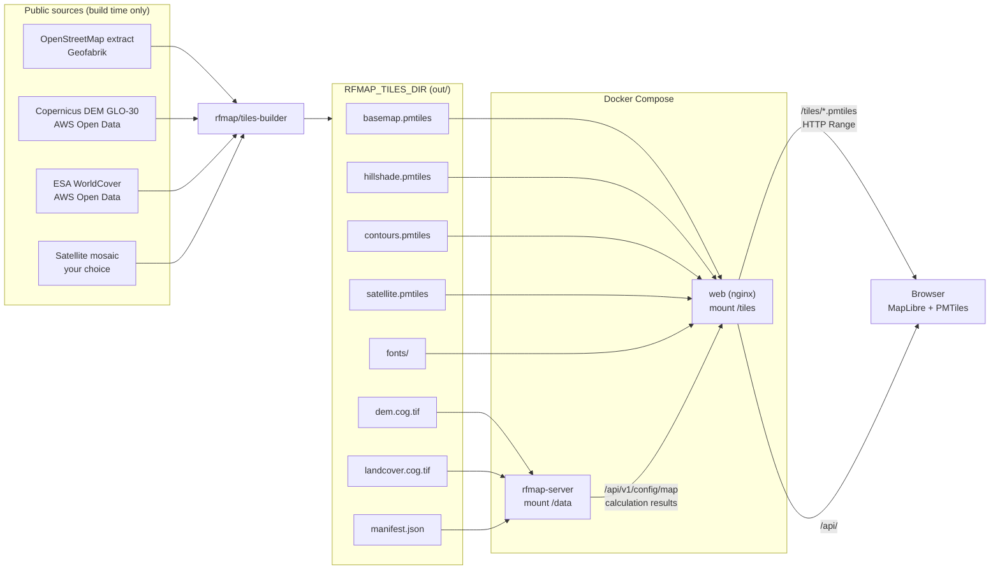
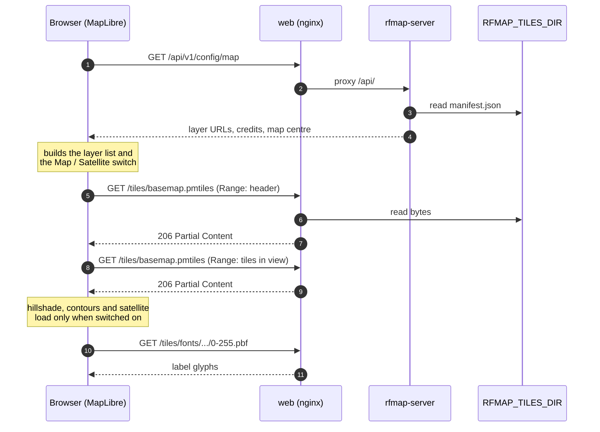
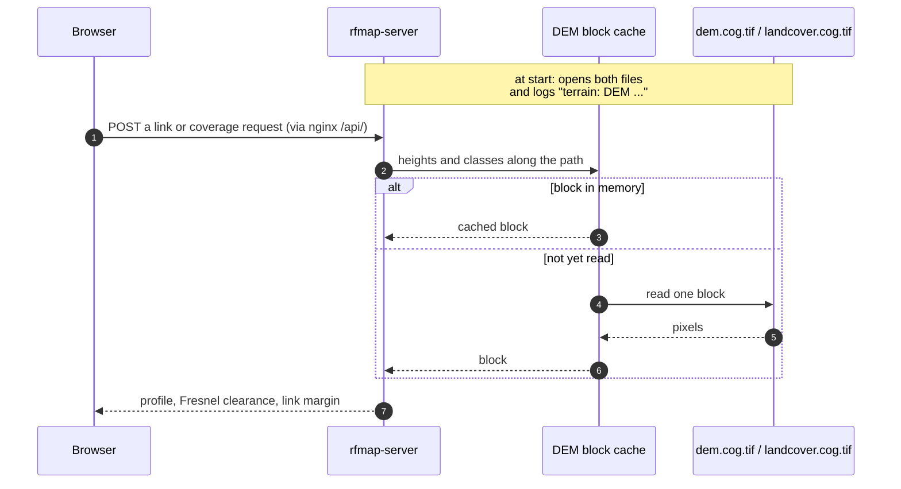

# How map layers reach the browser

This page follows the map data from the files `rfmap/tiles-builder` writes to the pixels in the
browser and the numbers in a calculation. It is for the person who runs the server and wants to
know what to change, and what to check, when a layer does not show. To build the layers, follow
[Production server, step by step](production-setup.md#2-build-the-map-data).

## The short version

- One directory holds every layer: the builder's `out/`, named by `RFMAP_TILES_DIR` in
  `deploy/.env`.
- Compose mounts it read-only into two containers: `rfmap-server` reads the rasters it
  calculates with, and `web` (nginx) serves the map tiles to browsers.
- The browser asks the server which layers exist, then reads the `.pmtiles` archives directly
  from nginx with HTTP Range requests. No tile server process runs and no third-party map
  service is called.

## Who reads which file

| File | Read by | How | Used for |
|---|---|---|---|
| `basemap.pmtiles` | browser | Range requests to `/tiles/basemap.pmtiles` | roads, places, water and buildings (vector tiles, OpenMapTiles schema) |
| `hillshade.pmtiles` | browser | Range requests | terrain shading (raster) |
| `contours.pmtiles` | browser | Range requests | contour lines (vector) |
| `satellite.pmtiles` | browser | Range requests | the **Satellite** base map (raster) |
| `fonts/` | browser | `/tiles/fonts/{fontstack}/{range}.pbf` | map labels (glyphs) |
| `dem.cog.tif` | rfmap-server | GDAL, from disk | terrain profiles, line of sight, Fresnel clearance, coverage |
| `landcover.cog.tif` | rfmap-server | GDAL, from disk | clutter losses along the path |
| `manifest.json` | rfmap-server | from disk, on each map settings request | which layers exist, and the credits shown on the map |
| `style-dark.json` | nobody in this stack | — | a ready-made MapLibre style for other clients; the web app builds its own style |

The `.tif` files never leave the server: nginx answers 404 for `/tiles/*.tif`.

## Step by step: opening the map

1. **Map settings.** The web app asks `GET /api/v1/config/map`. The server starts from fixed URLs
   for the builder's output names (`/tiles/basemap.pmtiles`, `/tiles/satellite.pmtiles`,
   `/tiles/hillshade.pmtiles`, `/tiles/contours.pmtiles`, `/tiles/fonts/{fontstack}/{range}.pbf`)
   and then:
   - reads `manifest.json` next to the DEM and drops every layer whose `.pmtiles` file the
     manifest does not list. A server without `satellite.pmtiles` therefore sends no satellite
     layer, and the browser shows no **Map / Satellite** switch and never asks for the file;
   - adds the attribution texts from the manifest, including your satellite mosaic's credit;
   - sets the map centre to the centre of `dem.cog.tif`;
   - merges the `map` object of the server configuration over the result, if there is one.

   The manifest is read on every request, so a newly built layer appears on the next page load,
   without a restart. If this request fails, the web app falls back to the same fixed URLs
   (`mapFallback` in `web/projects/fpv-app/src/environments/environment.ts`).
2. **Tiles.** MapLibre opens each archive through the `pmtiles://` protocol. It reads the
   archive's header and directory with one Range request, then fetches only the byte ranges
   of the tiles in view. nginx serves these as plain static files with `206 Partial Content`.
3. **Lazy layers.** The base map in view is loaded at start. Hillshade, contours and satellite
   imagery are added to the map only when the user turns them on, so a browser that never
   shows satellite imagery never downloads it.
4. **Caching.** nginx sends `Cache-Control: public, max-age=3600` for `/tiles/`. A rebuilt
   `.pmtiles` file reaches open browsers within an hour, or at once after a hard reload.

## Step by step: a calculation

- The server opens `dem.cog.tif` and `landcover.cog.tif` once, at start, from the paths in
  `data.dem` and `data.landcover` of its configuration (`/data/dem.cog.tif` and
  `/data/landcover.cog.tif` by default, or `RFMAP_DEM` and `RFMAP_LANDCOVER`).
- It reads them at full resolution, block by block, and keeps the blocks in a memory cache
  (`cache.demBlocksMb`, 256 MB by default; also under **Admin → Cache**). The hillshade and
  contour tiles are never used for calculations.
- Because the files are opened at start, **a rebuilt DEM or land cover file needs
  `docker compose restart rfmap-server`**. `GET /api/v1/health` shows `"dem":true` and
  `"landcover":true` once the server has them.

## What you can change

| You want to | Change |
|---|---|
| Use another tiles directory | `RFMAP_TILES_DIR` in `deploy/.env` (a full path, not `~/...`), then `docker compose up -d` |
| Serve the tiles from another host or a CDN | Copy `out/` there without the `.tif` files, and set the URLs in a `map` object in the server configuration (see [Configuration](deploy.md#3-configuration)). The other host must serve Range requests, must not compress `.pmtiles`, and needs CORS for `GET` and `HEAD` with the `Range` header. |
| Hide a layer you built | Remove it with the `map` object, for example `"map": {"satellite": null}` (a JSON merge patch) |
| Put a reverse proxy in front | It must forward `/tiles/` with the `Range` header and must not gzip `.pmtiles` (see [step 8](production-setup.md#8-tls)) |

## When a layer does not show

| Symptom | Check |
|---|---|
| Empty map, `/tiles/...` answers 404 | `RFMAP_TILES_DIR` does not point at the builder's `out/`. `docker compose exec web ls /tiles` must list the files. |
| No **Map / Satellite** switch | `curl -s http://127.0.0.1:8088/api/v1/config/map` has no `satellite` key: `satellite.pmtiles` is missing from `manifest.json`. Build the `satellite` step and run `verify`. |
| Map shows, but labels are missing | `fonts/` was not copied with the rest of `out/`. |
| Tiles load slowly or fail behind a proxy | The proxy drops the `Range` header or compresses `.pmtiles`. A request with `curl -sI -H 'Range: bytes=0-15' https://<your-site>/tiles/basemap.pmtiles` must answer `206`. |
| `health` shows `"dem":false` | The server could not open `/data/dem.cog.tif`. See its log: `docker compose logs rfmap-server | grep terrain`. |
| New DEM, old results | The server still has the old file open: `docker compose restart rfmap-server`. |
