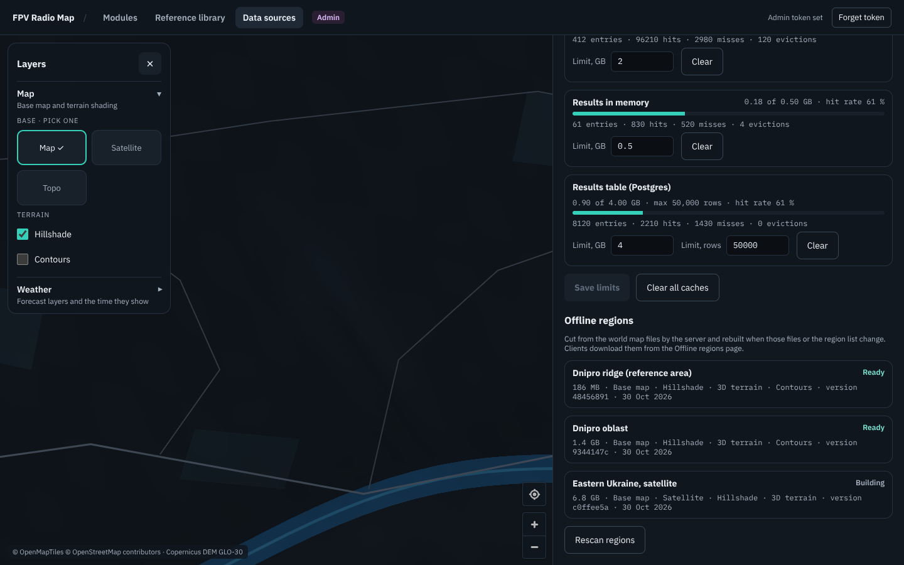
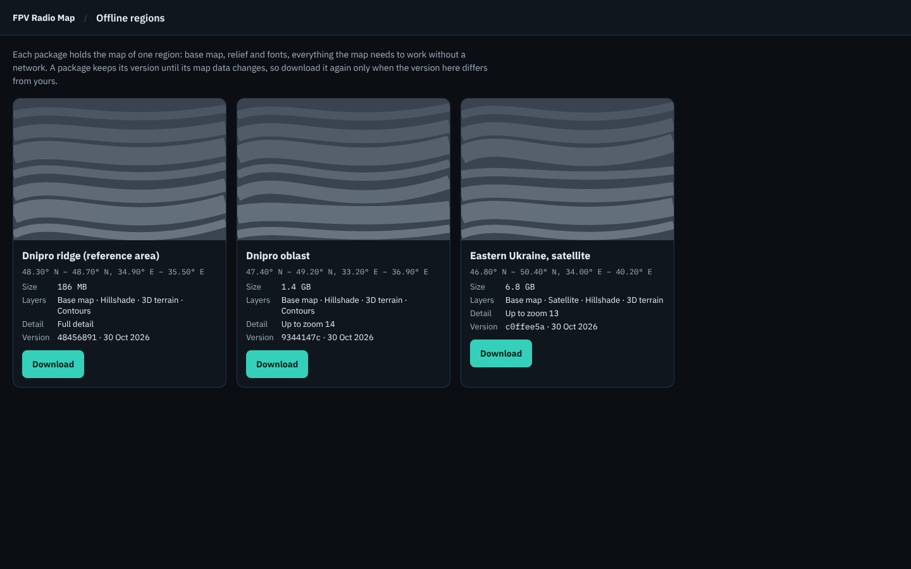

# Offline regions

This guide is for the person who runs the FPV Radio Map server. Offline regions let a pilot take
the map of one area into the field and use it without a network. The server keeps **one world-wide
set of map files** and cuts each region out of it. A whole planet is tens of gigabytes, which no
phone can hold. You describe the regions, and the server builds, versions and serves their
packages by itself. No external script runs for this.

```
world tiles-builder output ──► rfmap-server ──► one zip per region ──► GET /api/v1/regions
(basemap, hillshade, terrain,    cuts with go-pmtiles,                   "what to download",
 contours, satellite, style,     rewrites the style,                     "is there an update"
 fonts, sprites, DEM)            adds fonts, sprites, manifest
```

## 1. The world files

Build the map data once for the whole area you serve, which can be the planet, with
[tools/tiles-builder](tiles-builder.md). It is the same output directory the map already uses. The
server needs these files from it:

| file | in the package | notes |
|---|---|---|
| `basemap.pmtiles`, `hillshade.pmtiles`, `terrain.pmtiles`, `contours.pmtiles`, `satellite.pmtiles` | cut to the region, under `tiles/` | whichever were built; hillshade and terrain are separate layers |
| `style-dark.json` | as `style.json`, URLs rewritten | required |
| `fonts/<fontstack>/<range>.pbf` | the fontstacks the style uses, under `glyphs/` | the ranges the region asks for, or all of them |
| `sprites/sprite.json`, `sprite.png`, `sprite@2x.json`, `sprite@2x.png` | as they are, under `sprites/` | optional; the current dark style uses no icons |
| `dem.cog.tif` | no | the preview picture is drawn from it |

The COGs (`*.tif`) never go into a package. They are what the server calculates with, and the
browser cannot run the radio calculations. Calculations still need the server; an offline package
gives the map, the relief and the 3D terrain.

Set `regions.worldDir` to this directory. In the compose deployment it is `RFMAP_TILES_DIR`,
mounted at `/data`, and `RFMAP__REGIONS__WORLDDIR=/data` is already set.

## 2. Describe the regions

The regions are listed in a JSON file, `regions.definitions` (default
`/etc/rfmap/regions/regions.json`). In compose, put `regions.json` in the directory that `RFMAP_REGIONS_DIR` points to; compose mounts it
read-only at `/etc/rfmap/regions`.
Without the file, no region is offered.

```json
{
  "regions": [
    { "id": "kharkiv", "name": "Kharkiv oblast", "bbox": [34.8, 48.3, 37.0, 50.5] },
    { "id": "dnipro", "name": "Dnipro oblast", "boundary": "boundaries/dnipro.geojson",
      "maxzoom": 14, "layers": ["basemap", "hillshade", "terrain", "contours"],
      "glyphRanges": ["0-255", "1024-1279"] },
    { "id": "range-a", "name": "Test range A",
      "geometry": { "type": "Polygon", "coordinates": [[[35.0, 48.4], [35.3, 48.4], [35.2, 48.6], [35.0, 48.4]]] } }
  ]
}
```

| key | meaning |
|---|---|
| `id` | lower-case letters, digits and dashes, at most 64; it appears in the URLs |
| `name` | what the client shows; defaults to the id |
| `bbox` | `[minLon, minLat, maxLon, maxLat]` in degrees |
| `boundary` | a GeoJSON file (Polygon, MultiPolygon, Feature or FeatureCollection), relative to the definitions file and inside its directory: an administrative boundary, for example exported from OpenStreetMap |
| `geometry` | the same polygon written inline |
| `maxzoom` | the highest zoom to carry. Each zoom level roughly quadruples the size, so a large region for a phone wants 13 or 14 |
| `layers` | the layers to carry; default every layer the world has |
| `glyphRanges` | the font ranges to carry, which pick the scripts: `0-255` is Latin, `1024-1279` Cyrillic. Default is all ranges |

Give exactly one of `bbox`, `boundary` or `geometry`. A polygon is cut along its edge. The tiles
that cross the edge are kept whole, and the catalog shows the box around the polygon. An entry
that is wrong is logged and left out, and the other regions are still built.

## 3. What the server does with them

At start, every `regions.rescanMinutes` (default 10), and on `POST /api/v1/admin/regions/reload`
(**Admin → Data sources → Rescan regions**), a background thread compares each region with what it
was built from: its definition, the size and modification time of every world file it reads, and
the go-pmtiles version. For each region where something changed it:

1. runs `pmtiles extract <world layer> <cut> --bbox=…` (or `--region=<polygon>.geojson`, plus
   `--maxzoom`) for every layer. PMTiles is cut by copying the tiles inside the area; nothing is
   rendered again, so it is fast;
2. rewrites the style. Tile URLs become `pmtiles://tiles/<layer>.pmtiles`, glyphs become
   `glyphs/{fontstack}/{range}.pbf` and the sprite becomes `sprites/sprite`. Every URL is relative
   to the root of the package. Sources of layers the package lacks are dropped with their style
   layers, the terrain gets a `raster-dem` source, and the map is centred on the region;
3. writes `manifest.json` with the format, id, name, version, bbox, layers, the total bytes, and
   every file with its size and SHA-256;
4. stores everything in one zip without compression, since PMTiles and PNG are compressed
   already, and draws a small hillshade preview from `dem.cog.tif`;
5. records the new package, and only then removes the old one.

While a region is being rebuilt, clients keep getting its previous package. If a build fails, the
previous package stays current and the error is shown under **Admin → Data sources**. Packages of
regions that were taken out of the list, older versions and the leftovers of interrupted builds
are removed at the end of each scan. If `regions.json` cannot be read or is not valid JSON, the
scan logs the error and changes nothing, so a typo while editing never removes a package. Several server processes can share `regions.packageDir`: a
lock file lets one build at a time.



Disk: a package is about the size of the cut layers, so plan `regions.packageDir` (default
`/var/lib/rfmap/regions`, on the `rfmap-state` volume in compose) for the sum of all regions, plus
the largest one again while it is rebuilt.

## 4. Versions and updates

The **version** of a package is an opaque SHA-256 over everything in `manifest.json` except the
`version` field itself: format, format version, id, name, bbox, max zoom, layers, style, total
bytes, and each file's name, size and SHA-256. The zip is written the same way every time, with fixed times and owners. So rebuilding the
same tiles gives the same version, and a client downloads again only when something it would get
actually changed. Treat the version as an opaque name: compare it, do not compute it.

The preview has a version of its own, the SHA-256 of the PNG, because a new `dem.cog.tif` redraws
it without changing the package. Its URL in the catalog changes with it.

A client:

- reads `GET /api/v1/regions` (send its `ETag` back in `If-None-Match` to get `304` while nothing
  changed) for the name, preview, bbox, size, version and package URL of each region;
- shows "update available" when the version there differs from the one it stored;
- downloads `/api/v1/regions/<id>/packages/<version>.zip` again in full. That URL always names the
  same bytes, so it is cached for good and a broken download resumes with a `Range` request. Once
  the version is replaced, the old URL answers `404` with the current version;
- can check the download against `sha256` from the catalog, and every file against `manifest.json`.

Full downloads keyed by version are the simple and reliable choice. **Delta packages** (only the
tiles that changed since a given version) are a possible later extension. PMTiles directories make
it possible to compare two versions tile by tile, but the server does not offer them today.

The web app lists the regions under **Offline** (`/offline`), with a download button for each.



Saving a package inside the app and using it for the map without a network is the next step on
the client.

## 5. Settings

| Key | Default | Notes |
|---|---|---|
| `regions.worldDir` | empty (off) | The world tiles-builder output. Compose sets `/data`. |
| `regions.definitions` | `/etc/rfmap/regions/regions.json` | The region list; boundary files are read relative to it. |
| `regions.packageDir` | `/var/lib/rfmap/regions` | Written only by the server. |
| `regions.pmtiles` | `/usr/local/bin/pmtiles` | go-pmtiles. The server image carries the same pinned release as tools/tiles-builder. It is started directly with fixed arguments and an empty environment, never through a shell. |
| `regions.rescanMinutes` | 10 | 0 = only at start and on reload. A scan that finds nothing changed reads no tile data. |
| `regions.maxDownloads` | 0 (automatic) | Package downloads streamed at once. Each one holds a request thread until the client has it all, so a further one gets `503` with `Retry-After` instead of starving the other requests. Automatic is a quarter of `server.threads`, at least one. Metrics show it as the `downloads` gate. |

The bundled nginx streams package downloads without buffering them (`proxy_buffering off`) and
passes Range requests through. Behind another proxy, do the same for
`/api/v1/regions/*/packages/`.

## 6. API

| | |
|---|---|
| `GET /api/v1/regions` | the catalog, with ETag |
| `GET /api/v1/regions/{id}` | one region |
| `GET /api/v1/regions/{id}/packages/{version}.zip` | the package; Range, ETag, immutable |
| `GET /api/v1/regions/{id}/previews/{previewVersion}.png` | the preview |
| `GET /api/v1/admin/regions` | every region with `ready`, `building` or `failed` and the last error |
| `POST /api/v1/admin/regions/reload` | scan now |

Details are in the [OpenAPI description](../api/openapi.yaml).
