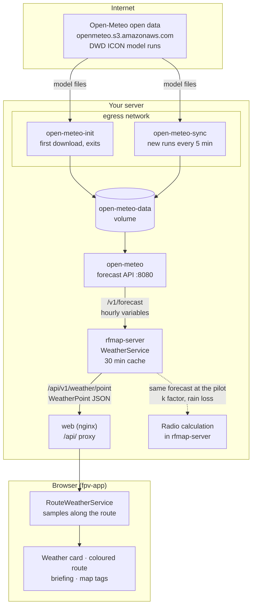
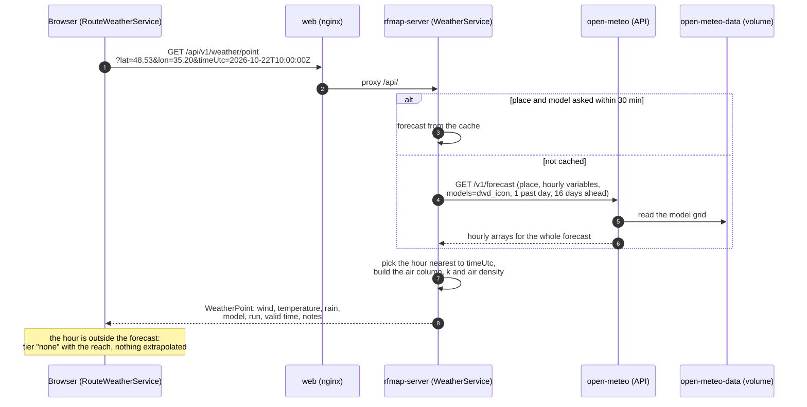
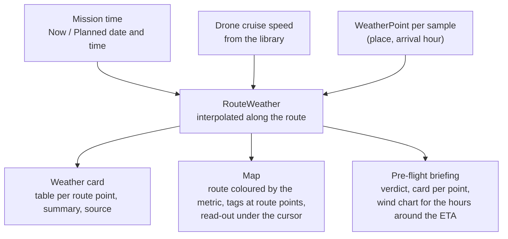

# How the weather forecast reaches the pilot

This page follows the forecast from the national weather services to the numbers and colours
the pilot sees: the weather card, the coloured route in **Weather** mode, the pre-flight briefing
and the radio calculation. It is for the person who runs the server and wants to know what each
container does, what to check when the forecast is missing, and what leaves the network. To set
the containers up, follow [Deployment, section 4](deploy.md#4-open-meteo).

## The short version

- Open-Meteo runs on your server, in three containers that share one volume.
  `open-meteo-init` downloads a first copy of the model data and exits. `open-meteo-sync` keeps it
  fresh, checking for a new model run every 5 minutes. `open-meteo` answers forecast requests
  from that copy.
- Only the two sync containers can reach the internet (the `egress` network). They download
  the model files from Open-Meteo's open data bucket. The API, rfmap-server and the database have
  no route out.
- The browser never talks to Open-Meteo. It asks rfmap-server through nginx
  (`GET /api/v1/weather/point`). rfmap-server asks the local API and caches the answer for 30
  minutes. It then picks the forecast hour nearest to the time asked and returns one point in the
  app's own format.
- The calculation reads the same forecast at the pilot's position. It uses it for refraction (the
  effective earth radius factor k) and for rain attenuation.

## The containers

| Container | Networks | Runs | Does |
|---|---|---|---|
| `open-meteo-init` | `backend`, `egress` | once, before the API starts | `sync` of the models in `OPEN_METEO_SYNC_MODELS` and the variables in `OPEN_METEO_VARIABLES`, with one past day. Exits when done. |
| `open-meteo-sync` | `backend`, `egress` | all the time | the same `sync`, repeated every 5 minutes; it downloads only what changed |
| `open-meteo` | `backend` | all the time | the Open-Meteo API on port 8080. It reads the files in the volume and derives `surface_pressure` and the 10 m wind speed and direction from what is stored |
| `rfmap-server` | `backend`, `frontend` | all the time | asks `http://open-meteo:8080` (`RFMAP_OPEN_METEO_URL`) and turns the answer into the app's `WeatherPoint` |
| `web` | `frontend`, `public` | all the time | the only published port. Serves the app and passes `/api/` to rfmap-server |

The `backend` and `frontend` networks are internal, so a forecast request never leaves your
server. The only outbound traffic for the weather is the sync containers downloading model files.

## Step by step: one forecast point

1. **The browser asks.** In **Weather** mode the app samples the route: every route point, plus a
   sample about every kilometre along the whole route, at most 24 of them. For each sample it
   works out the arrival time from the mission time (**Now** or **Planned**) and the drone's
   cruise speed. With no drone from the library it assumes 10 m/s. It rounds each place to 0.01°
   and each time to the hour, so nearby samples share one request. It sends at most 4 requests
   at a time, and waits 400 ms after the last route edit before it starts.
2. **nginx passes it on.** `location /api/` in `deploy/nginx.conf` proxies to
   `rfmap-server:8080`. The browser, the API and the tiles share one origin, so no CORS is needed.
3. **rfmap-server reads the forecast.** `WeatherService` (`server/src/weather.cpp`) keeps every
   Open-Meteo answer for `weather.cacheMinutes` (30) per place and model. A new place asks
   `open-meteo` for the whole forecast at once: the surface values, wind, rain, and temperature,
   humidity and geopotential height at 1000 to 850 hPa. That is one past day and 16 days ahead,
   with a timeout of 8 s.
4. **It picks the hour.** The server takes the forecast hour nearest to `timeUtc`. From the
   surface air and the pressure levels above the ground it builds the air column. It then computes
   the refractivity gradient, the k factor and the air density. When the time is outside the
   forecast it answers `tier: "none"` with `forecastUntilUtc`, and the app says
   *No forecast covers this flight time*. When Open-Meteo cannot be reached it answers with
   `error`, and the app shows the error with a **Retry** button.
5. **The app draws it.** `RouteWeather` interpolates between the samples, then the app colours
   each part of the route by the chosen value (headwind, wind, temperature or rain). The weather
   card lists every route point at its arrival time. The briefing asks the same endpoint for the
   hours around each arrival, for its wind charts.

## What the pilot sees

The source line under the card names the model and the run, from the `model` and `runUtc` of
the answers. It adds *forecast run is old* when the run is older than `weather.staleAfterHours`
(12 h). That happens when `open-meteo-sync` has stopped downloading.

## The forecast in the radio calculation

Weather mode is only a view. The calculation reads the forecast on its own: for each calculation
the server asks `WeatherService` for the pilot's position at the mission time. It uses the
air column for the effective earth radius factor k, and `precipitation` for rain attenuation
(ITU-R P.838-3). The forecast is part of the result's cache key, so a new model run gives a new
result. With no forecast (none configured, unreachable, or beyond its reach) the calculation uses
the standard atmosphere, k = 4/3, with no rain term. The result's notes say which was used.

## Settings

| Setting | Where | Default | Effect |
|---|---|---|---|
| `OPEN_METEO_SYNC_MODELS` | `deploy/.env` | `dwd_icon,dwd_icon_global_eps_native` | model directories the sync containers download |
| `OPEN_METEO_VARIABLES` | `deploy/.env` | the stored variables the server needs | what the sync containers download |
| `OPEN_METEO_MODELS` | `deploy/.env` | `dwd_icon` | the `models` parameter rfmap-server asks for |
| `RFMAP_OPEN_METEO_URL` / `weather.baseUrl` | compose / server config | `http://open-meteo:8080` | where rfmap-server asks; empty = no forecasts, k = 4/3 everywhere |
| `weather.forecastDays` | server config | 16 | how far ahead it asks |
| `weather.cacheMinutes` | server config | 30 | how long one answer is kept |
| `weather.timeoutMs` | server config | 8000 | how long it waits for Open-Meteo |
| `weather.staleAfterHours` | server config | 12 | when the run counts as stale |
| `weather.metaUrl` | server config | empty | a model `meta.json` that gives the run time; without it the run is not shown |

## When the forecast is missing

| What the app shows | Likely cause | Check |
|---|---|---|
| *The forecast could not be loaded*, with an error | rfmap-server cannot reach `open-meteo`, or it answered an error | `docker compose logs open-meteo`; the curl test in [Deployment, section 4](deploy.md#4-open-meteo) |
| *No forecast covers this flight time* | the planned time is more than about 16 days ahead, or the sync has not run yet | `docker compose logs open-meteo-init open-meteo-sync` |
| The source line says *forecast run is old* | `open-meteo-sync` is stopped or cannot download | `docker compose ps`; the `egress` network |
| Weather mode stays on *Loading the forecast…* | the request is slow; each one waits up to 8 s | the server log for `weather` |

## In development

`npm start` in `web/` runs the app against an in-browser mock backend
(`web/projects/fpv-app/src/app/mock/`). There `GET /weather/point` comes from `weatherAt()` in
`reference-case.ts`, a made-up forecast in which the wind freshens towards the north-east. No
Open-Meteo is involved, and no request leaves the browser.
